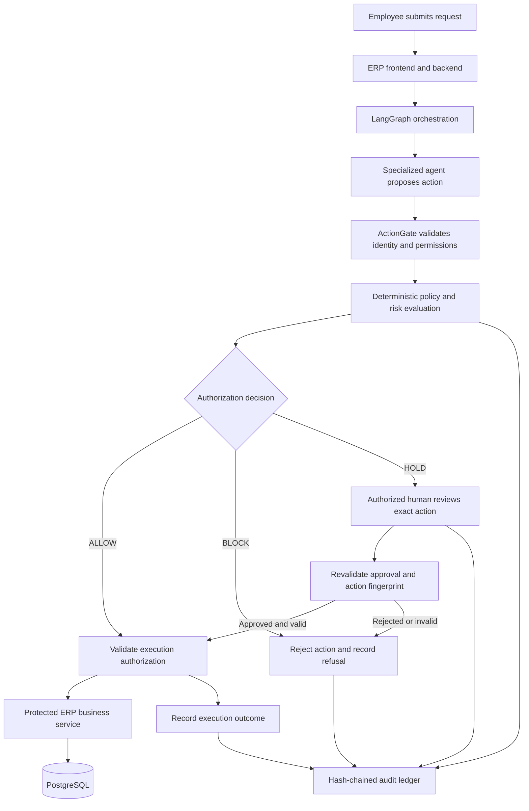

# ActionGate
### AI Agent Action Authorization Engine

**VORTEXA 3.0 · Problem Statement C-01 · Cybersecurity & Digital Trust**

ActionGate is an authorization gateway that evaluates AI agent actions before they execute against business systems. Integrated with a small-company ERP, it demonstrates how organizations can use AI agents for business workflows without giving those agents unrestricted authority.

AI agents can interpret requests, prepare expense claims, propose employee-record changes, and initiate other business operations. However, a model's interpretation of a request does not guarantee that its proposed action is safe, authorized, or consistent with the user's actual intent.

ActionGate introduces a security boundary between AI agents and protected business operations. Every proposed action is evaluated against deterministic policies, verified permissions, and risk criteria before receiving one of three outcomes: **ALLOW, HOLD, or BLOCK**.

The project combines explainable risk assessment, action-bound human approval, protected execution, and tamper-evident auditing in a demonstrable ERP environment.

All repository demo data is fictional.

---

## 1. Problem Statement

AI agents are increasingly capable of taking actions rather than simply generating responses. When connected to enterprise systems, an agent may misunderstand a user request, follow malicious instructions embedded in untrusted content, select an inappropriate tool, or propose an operation with unintended consequences.

Traditional tool permissions alone may not adequately address these risks. An agent may have access to a permitted tool but still use it incorrectly, target the wrong record, or attempt an operation that requires additional authorization.

ActionGate addresses this problem by evaluating the **proposed action itself**, independently of the agent's confidence or intention.

### Our approach

- Intercept agent-proposed actions before protected execution.
- Enforce verified identity, permissions, and deterministic security policies.
- Calculate an explainable risk score to support the authorization decision.
- Require human approval for actions that need additional review.
- Bind approvals to the exact action so modified requests cannot reuse previous approvals.
- Record decisions, approvals, refusals, and execution outcomes in a verifiable audit history.
- Contain the impact of prompt injection and agent misinterpretation through server-side controls.

**Core principle: AI proposes. ActionGate authorizes. Protected services execute. The audit ledger records.**

## 2. Core Security Guarantees

1. **Deterministic authorization:** Explicit policies make the final authorization decision. AI advice cannot override mandatory security rules.
2. **Three possible outcomes:** Every evaluated action receives ALLOW, HOLD, or BLOCK.
3. **Default deny:** Unknown agents, unsupported action types, and unverified permissions cannot authorize execution.
4. **AI advisory boundary:** An AI advisor may recommend stricter handling, such as escalating an action to HOLD. It cannot relax a deterministic BLOCK or independently grant authorization.
5. **Action-bound approvals:** Approval is tied to a canonical representation of the exact action using a SHA-256 fingerprint.
6. **Single-use and expiring approvals:** An approval cannot be reused indefinitely or applied to a different action.
7. **Separation of duties:** A requester cannot approve their own request.
8. **Fail-safe operation:** If required authorization cannot be completed, protected execution does not proceed. If the AI advisor is unavailable, deterministic policies can still operate where all required inputs and dependencies are available.
9. **Tamper-evident auditing:** Decisions, refusals, approvals, and execution outcomes are recorded in a hash-chained audit history with verification support.
10. **Constrained execution:** Agents cannot access PostgreSQL directly or bypass the protected execution boundary.
11. **Prompt-injection containment:** Untrusted content is identified and tracked so that malicious instructions cannot independently grant permissions or expand an agent's authorized scope.

These are design objectives that must be verified against the implementation and automated tests. They are not claims of universal protection against every attack.

## 3. System Architecture


The system consists of the following layers:

| Component | Responsibility |
|---|---|
| ERP frontend | Next.js and React interface for employee workflows, dashboard, chatbot, approval queue, and audit viewing |
| ERP backend | FastAPI APIs, authentication, role-based access control, and business services |
| Agent orchestration | LangGraph intent routing and specialized HR, Leave, and Finance agents |
| ActionGate engine | Identity and permission validation, deterministic policy evaluation, risk scoring, approval management, and audit logging |
| Protected execution | Executes allowlisted ERP business operations only after authorization is validated |
| Integrations | Optional email and chat simulation, ingestion screening, IVR, voice, and notifications |
| PostgreSQL | Stores ERP business records and the persistent policy, approval, and audit data managed by the application |
| Attack Lab | Runs security scenarios, attack tests, mutation tests, and demonstrations of authorization failures |

### Action lifecycle



### Protected execution boundary

Agents must not have direct ERP database credentials or unrestricted write access. Agent-originated protected operations must pass through ActionGate and a server-side execution boundary.

A gate-issued authorization must be short-lived, bound to the relevant action, and validated by the execution layer. Authorization must be rechecked immediately before the business operation executes.

Normal ERP operations performed directly by users remain subject to the ERP's own authentication, role checks, and business validation. The integration must explicitly define which operations require ActionGate rather than assuming that every human-initiated ERP operation automatically passes through it.

## 4. Authorization and Risk Assessment

ActionGate combines deterministic policies with an explainable weighted risk score.

### Weighted Action Risk Score (WARS)

The initial model is:

**WARS = 0.30I + 0.20S + 0.25R + 0.15P + 0.10U**

Where each factor is normalized to a value from 0 to 100:

| Factor | Meaning |
|---|---|
| I — Impact | Potential business consequences if the action is executed incorrectly |
| S — Sensitivity | Sensitivity of the affected data or operation |
| R — Reversibility risk | Difficulty of undoing the action or recovering from its consequences |
| P — Permission risk | Risk associated with the requester's authorization context |
| U — Uncertainty | Uncertainty in the available, verified information needed to evaluate the action |

The weights are initial configurable demo values. They must be documented, tested, and tuned against representative scenarios; they are not empirically validated risk probabilities.

The score supports the policy engine but does not replace mandatory checks.

### Decision behavior

- **ALLOW:** The action satisfies the required permissions and policies and may proceed through protected execution.
- **HOLD:** The action requires review or additional authorization. It remains unexecuted until the required approval and revalidation succeed.
- **BLOCK:** The action violates a mandatory rule, lacks required authorization, or is otherwise prohibited.

A high score does not automatically mean an action can be approved. For example, a user attempting to approve their own expense must be blocked by policy even if the numerical score is low.

Every decision should include its decision ID, reason codes, applicable policy version, action fingerprint, and audit reference.

## 5. Human Approval and Action Integrity

Human approval is a security control, not merely a confirmation dialog.

When an action requires approval, ActionGate binds the approval to the canonical action using a SHA-256 fingerprint.

The approval lifecycle includes:

1. Evaluate the proposed action.
2. Create a HOLD decision when review is required.
3. Present the exact action and relevant context to an authorized approver.
4. Verify that the approver is authenticated, eligible, and distinct from the requester.
5. Bind the approval to the action fingerprint, requester, policy version, and expiry.
6. Revalidate the action and approval immediately before execution.
7. Reject expired, reused, revoked, or mismatched approvals.
8. Record the approval and execution outcome in the audit history.

Changing the target, amount, operation, or other security-relevant parameters requires a fresh authorization decision and, where applicable, a new approval.

A conversational response such as "yes, do it" is not a substitute for verified approval through the authorized workflow.

## 6. Prompt-Injection Defense

ActionGate assumes that an AI agent may be influenced by malicious or misleading input. Its security model therefore focuses on limiting the consequences of an incorrect agent decision rather than relying entirely on prompt-injection detection.

### Defense mechanisms

- **Trust labels:** Incoming email, chat messages, and free-text ERP fields are treated as untrusted content.
- **Ingestion screening:** Incoming content may be normalized and classified to identify suspicious instructions. Screening is an additional safeguard, not the final authorization mechanism.
- **Trusted task scope:** The backend creates a task record defining the permitted context and action scope. The agent cannot expand that scope by itself.
- **Provenance tracking:** The system tracks where relevant action parameters originated.
- **Argument-origin checks:** Sensitive values supplied by untrusted content are checked against verified ERP records and held when required verification is missing.
- **Approval provenance:** Approvers can inspect the source of the request and relevant evidence before authorizing an action.
- **Server-side enforcement:** The policy engine independently checks permissions and action constraints regardless of what the LLM recommends.

This design provides containment, not guaranteed prevention. Detection may miss attacks, so testing must measure both successful containment and failures.

## 7. Security Testing and Attack Lab

The `attacks/` directory contains security tests and the Attack Lab used to demonstrate the system's behavior under adversarial conditions.

| Test group | Coverage |
|---|---|
| Core gateway attacks | Unknown agents and actions, self-approval, changed actions after approval, approval replay, AI unavailability, audit tampering, execution without authorization, refusal logging, and duplicate execution |
| AI invariant | Property test verifying that AI advice never makes a deterministic policy decision less strict |
| Injection contract | Task-scope enforcement, argument provenance, forged provenance, unauthorized scope expansion, and task-bound restrictions |
| End-to-end scenarios | Prompt-injection attempts delivered through simulated email, chat, invoices, support tickets, and ERP records |
| Mutation testing | Deliberately weakened gateway implementations that the test suite is expected to detect |

### Testing tiers

**Tier A — Deterministic security tests**

Provide a proposed action to the gateway and verify the decision, audit result, and actual ERP state change. These tests should run without a live LLM.

**Tier B — Real-agent evaluation**

Use a configured LLM agent to measure how frequently adversarial inputs manipulate its proposed actions and whether ActionGate contains the resulting behavior. Report run counts and observed failures rather than claiming perfect protection.

**Mutation testing**

Introduce deliberately vulnerable gateway variants and verify that the security suite detects them.

**Attack Lab**

Provide a judge-facing interface with predefined attack scenarios and, if implemented, a bounded free-form attack input. Any model-assisted testing must use constrained tools and must not expose administrative powers or unrestricted business operations.

## 8. Repository Structure

```text
actiongate/
├── README.md
├── .env.example
├── docker-compose.yml
├── Makefile
├── docs/
│   ├── architecture.png
│   ├── threat-model.md
│   ├── api-contract.md
│   ├── test-provenance.md
│   └── demo-script.md
├── frontend/              # Next.js ERP and demo interfaces
├── backend/               # FastAPI ERP and protected execution
├── agents/                # LangGraph orchestration and agent adapters
├── actiongate/            # Authorization, risk, approval, and audit engine
├── integrations/          # Optional email, chat, IVR, and notifications
├── attacks/               # Security, injection, and mutation tests
└── scripts/               # Database seeding, reset, and demo helpers
```

Actual repository contents and module ownership should be verified as components are merged. The structure above describes the intended organization.

## 9. Local Setup

### Prerequisites

- Python 3.11 or newer
- Node.js 20 or newer
- Docker and Docker Compose
- PostgreSQL, either through Docker or an equivalent local installation

### Intended startup workflow

The following commands are the intended workflow and must be verified against the actual Makefile, package scripts, and environment configuration before use.

```bash
cp .env.example .env

docker compose up -d db

make install
make seed

make dev
```

In a separate terminal, run the project's documented tests:

```bash
make test
make mutations
make report
```

The actual commands, services, and expected outputs should be documented after the integrated repository has been tested successfully.

## 10. Configuration

Copy `.env.example` to `.env` and configure only the services needed for your environment. Never commit real credentials.

| Variable | Purpose |
|---|---|
| `DATABASE_URL` | PostgreSQL connection |
| `LLM_PROVIDER` | Configured provider such as OpenAI, Gemini, or a local fallback |
| `OPENAI_API_KEY` | Optional server-side OpenAI access |
| `GEMINI_API_KEY` | Optional server-side Gemini access |
| `ELEVENLABS_API_KEY` | Optional spoken summaries |
| `TWILIO_*` | Optional real telephony integration |
| `GATE_SIGNING_KEY` | Signing authorization tokens |
| `ATTACK_TEST_MODE` | Enables test-only hooks; must be disabled in the demo build |

Use separate development and demonstration configurations. Signing keys and other secrets must be securely generated and must never be embedded in frontend code.

The core demonstration should prioritize local operation and deterministic fallback behavior. Optional hosted LLM, speech, and telephony integrations must not become authorization bypasses or mandatory dependencies for deterministic gateway tests.

## 11. Demonstration Scenario

The demonstration should show the difference between an AI agent proposing an action and a secure system authorizing it.

1. **Routine action:** An employee submits a low-risk expense claim. The agent proposes the action, ActionGate evaluates it, and the ERP records it only after authorization.
2. **Prompt-injection attempt:** A simulated expense email contains an instruction to redirect reimbursement to a different bank account. The agent proposes the altered action, but ActionGate identifies the relevant provenance and requires verification or blocks the action according to policy.
3. **Human approval:** An authorized manager reviews the exact held action and approves or rejects it through the supported approval interface. Optional IVR can demonstrate the same approval flow.
4. **Changed action:** An agent changes the amount or target after approval. ActionGate rejects reuse of the original approval.
5. **Audit verification:** A controlled test modifies an audit record. The audit verifier detects the broken hash chain.
6. **Judge-led testing:** Judges can trigger supported Attack Lab scenarios and inspect the decisions and resulting system state.

The demonstration must show actual decision records and business-state changes, not only chatbot messages.

## 12. Team Development Workflow

- Use feature branches and pull requests.
- Prefer small, focused commits using Conventional Commits, such as `feat(actiongate): add approval validation` or `test(attacks): cover approval replay`.
- Keep the shared API contract synchronized across the ERP, ActionGate, and agent-orchestration components.
- Run relevant tests before merging.
- Document integration changes that affect another component.
- Keep mocks separate from real service adapters.
- Verify the full end-to-end workflow before declaring integration complete.

## 13. Known Limitations

- This is a prototype intended for a controlled demonstration, not a production-ready enterprise security product.
- Demo identities, sample records, tools, and approval methods may be simulated.
- Risk-score weights and thresholds require further calibration against representative real-world cases.
- Prompt-injection screening cannot guarantee detection of every malicious instruction.
- A hash chain detects certain forms of tampering but cannot independently prevent all deletion, truncation, or full-history rewrite attacks. Stronger deployments need protected external checkpoints or equivalent independent verification.
- Real telephony, speech, and hosted AI integrations are optional and may use simulated alternatives.
- Production deployment would require further work on key management, concurrency, operational monitoring, access governance, privacy, and independent security assessment.

## 14. References

- OWASP Top 10 for LLM Applications 2025 — including Prompt Injection and Excessive Agency.
- OWASP Top 10 for Agentic Applications 2026.
- Zhan et al. (2024), *InjecAgent: Benchmarking Indirect Prompt Injections in Tool-Integrated LLM Agents*. The project scenarios are inspired by this class of attack and are not a reproduction of the benchmark.
